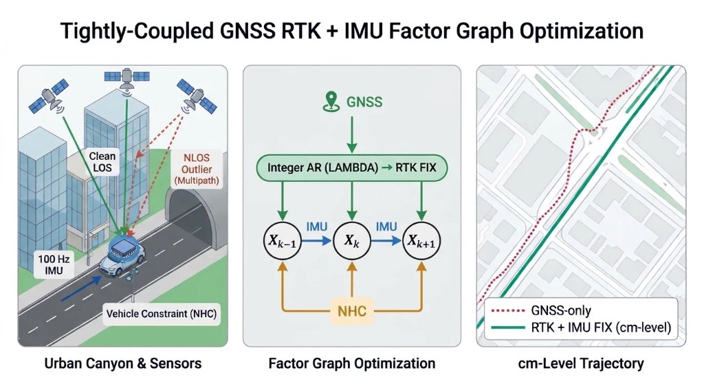
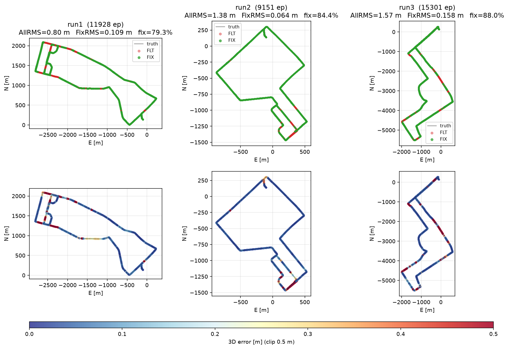

# tightly-coupled-gnss-imu-fgo

**Open-source tightly-coupled GNSS RTK + IMU factor-graph optimization**

*carrier-phase RTK · LAMBDA ambiguity resolution · GTSAM · urban driving · reproducible*

The full RTK chain lives inside the graph: double-differenced
pseudorange **and carrier phase** with Cauchy M-estimator noise,
continuous integer ambiguity resolution (LAMBDA + partial AR), and
100 Hz IMU preintegration — targeting centimeter FIX in deep urban
canyons, with IMU + single-differenced Doppler bridging NLOS storms
and tunnels.



## What's inside

- **RTK in the graph** — DD pseudorange + DD carrier-phase factors with
  Cauchy robust noise (`k = 2.385`) on a QR-factorized GTSAM
  `IncrementalFixedLagSmoother`, float ambiguities chained via per-epoch
  random walk, clock-free seeding (SD phase − SD code)
- **Integer ambiguity resolution** — continuous LAMBDA + partial AR
  with a dimension-adaptive fixed-failure-rate ratio test (FFRT) and
  full-AR DD integer fix-and-hold (`armode=2`)
- **Tight IMU coupling** — 100 Hz `CombinedImuFactor` preintegration;
  NHC vehicle constraint (C++ factor with exact Jacobians)
- **Velocity through outages** — between-satellite single-differenced
  Doppler (clock-free), injected on every epoch
- **Integrity & recovery** — LLI + geometry-free cycle-slip detection
  and ambiguity reset/re-seeding
- **GTSAM integration** — DD and Doppler factors are upstream in
  [GTSAM](https://github.com/borglab/gtsam) (see the
  [gtsam.org post](https://gtsam.org/2026/06/10/rtk-gnss-double-difference.html));
  NHC and SD Doppler are contributed / pending upstream

## Results

Everything is measured on open data with all-default settings, and is
reproducible end to end — three full urban-Tokyo drives and three
urban-Nagoya drives
([PPC-Dataset](https://github.com/taroz/PPC-Dataset)):

### Sequential (`examples/run_imu_gnss_tc.py`)

| run         | length    | AllRMS  | median  | FixRMS  | fix %  | <50 cm | Max     |
|-------------|-----------|---------|---------|---------|--------|--------|---------|
| tokyo run1  | 11951 ep  |  0.96 m | 0.039 m | 0.09 m  | 78.1 % | 88.6 % | 13.91 m |
| tokyo run2  |  9151 ep  |  0.84 m | 0.032 m | 0.06 m  | 86.2 % | 90.7 % |  9.16 m |
| tokyo run3  | 15301 ep  |  0.69 m | 0.029 m | 0.06 m  | 89.7 % | 97.6 % | 13.66 m |
| nagoya run1 |  7651 ep  |  0.74 m | 0.122 m | 0.12 m  | 81.6 % | 88.6 % |  8.31 m |
| nagoya run2 |  9451 ep  |  1.24 m | 0.232 m | 0.36 m  | 63.6 % | 59.6 % |  4.73 m |
| nagoya run3 |  5201 ep  |  0.35 m | 0.127 m | 0.13 m  | 66.7 % | 88.1 % |  1.69 m |




### Batch (`examples/run_batch_tc.py`)

Whole-run MAP smoothing (Huber initial convergence → Cauchy `k = 2.385` polish, Partial AR + FFRT):

| run         | length    | AllRMS  | median  | FixRMS  | fix %  | <50 cm | Max     |
|-------------|-----------|---------|---------|---------|--------|--------|---------|
| tokyo run1  | 11928 ep  |  0.24 m | 0.041 m | 0.09 m  | 61.9 % | 96.3 % |  1.53 m |
| tokyo run2  |  9151 ep  |  0.21 m | 0.032 m | 0.06 m  | 66.1 % | 96.2 % |  1.47 m |
| tokyo run3  | 15301 ep  |  0.14 m | 0.035 m | 0.07 m  | 72.1 % | 98.8 % |  2.12 m |
| nagoya run1 |  7602 ep  |  0.62 m | 0.120 m | 0.12 m  | 69.8 % | 93.8 % |  4.53 m |
| nagoya run2 |  9451 ep  |  1.03 m | 0.212 m | 0.42 m  | 53.0 % | 73.1 % |  3.84 m |
| nagoya run3 |  5201 ep  |  0.21 m | 0.117 m | 0.17 m  | 54.0 % | 97.6 % |  1.36 m |

## Quick start

Linux x86_64, Python 3.12 (CI-tested; 3.11 should work). Requires `g++`, `git`, and
Boost headers (`libboost-dev`) to build the local C++ extension
(`gnss_fgo._extra_factors`: `SingleDifferenceDopplerFactor*`, `NhcFactor*`, and
`TdcpFactor*`) against your installed `gtsam` shared library.

```bash
uv venv --python 3.12 && source .venv/bin/activate
uv pip install numpy matplotlib setuptools

# Official GTSAM (with DoubleDifference* factors; or a prebuilt wheel from inuex35/gtsam):
uv pip install gtsam

# cssrlib DD-only RTK core (pinned; carries nav.sat_band_plan,
# satposs signal-flight-time fix, indexed findeph bisect, and sync_obs_hold dt_fill):
uv pip install "cssrlib @ git+https://github.com/inuex35/cssrlib.git@6f7a56caf3e4eb5e8cd6159e8456a785110d8d09"

# Build the SD-Doppler & NHC C++ extension locally and install gnss-fgo:
uv pip install --no-build-isolation --no-deps -e .
```

(`setup.py` shallow-clones `borglab/gtsam` headers into `/tmp/gnss_fgo_gtsam_headers` to
generate `config.h` and links directly against `libgtsam.so` inside your installed `gtsam`
package without rebuilding GTSAM itself. Set `GTSAM_SRC_DIR` / `GTSAM_BUILD_DIR` if you
already have a local GTSAM tree. Once `NhcFactor*` is merged upstream into GTSAM,
only `SingleDifferenceDopplerFactor*` remains in the local extension.)

Run (datasets not included; lay out PPC-Dataset under
`data/PPC-Dataset/tokyo/run{1,2,3}/`):

```bash
LEVER_ARM=0.31,0,0.55 \
python examples/run_imu_gnss_tc.py \
  rover.obs base.obs base.nav imu.csv reference.csv
```

## Architecture

Flat module layout under `src/gnss_fgo/`:

| Module | Role |
|---|---|
| `runner.py` | `ImuGnssTc.process(obs, obsb)` entry point and epoch flow (`bootstrap` / IMU prediction → slip check → factors → iSAM2 → `run_ar`) |
| `factors.py` | measurement → GTSAM factor builders (DD PR/CP, SD Doppler, NHC, ambiguity seeding), `SatStateMap`, and cycle-slip detection |
| `ar.py` | LAMBDA + partial AR with dimension-adaptive FFRT and full-AR fix-and-hold |
| `config.py` | `TcConfig` and `BatchConfig` |
| `utils.py` | geometry, IMU params/preintegration, signal auto-detection, Huber / Cauchy robust noise |
| `batch.py`, `batch_ar.py`, `batch_graph.py` | offline whole-run batch TC pipeline and global AR |

## Configuration

Every `TcConfig` field in `config.py` is an env var (`ERR_A`, `ERR_ERATIO_PR`,
`ELMIN_DEG`, `AMB_RW_SIGMA`, `ARMODE`, `FLS_LAG`, …) — see
`config.py` for all 11 parameters. The example script adds its own
env switches (`LEVER_ARM`, `MAX_EP`, `SAVE_NPZ`, …).

## License

BSD 3-Clause. Built on [GTSAM](https://github.com/borglab/gtsam) and
[cssrlib](https://github.com/hirokawa/cssrlib); evaluated on
[PPC-Dataset](https://github.com/taroz/PPC-Dataset).
