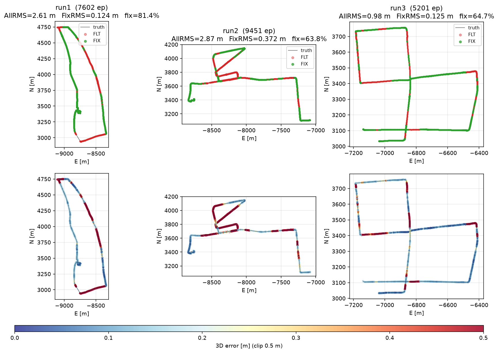

# tightly-coupled-gnss-imu-fgo

**Open-source tightly-coupled GNSS RTK + IMU factor-graph optimization**

*carrier-phase RTK · LAMBDA ambiguity resolution · GTSAM · urban driving · reproducible*

The full RTK chain lives inside the graph: double-differenced
pseudorange **and carrier phase** with Huber M-estimator noise,
continuous integer ambiguity resolution (LAMBDA + partial AR), and
100 Hz IMU preintegration — targeting centimeter FIX in deep urban
canyons, with IMU + single-differenced Doppler bridging NLOS storms
and tunnels.

## What's inside

- **RTK in the graph** — DD pseudorange + DD carrier-phase factors with
  Huber robust noise on a QR-factorized GTSAM
  `IncrementalFixedLagSmoother`, float ambiguities chained via per-epoch
  random walk, clock-free seeding (SD phase − SD code)
- **Integer ambiguity resolution** — continuous LAMBDA + partial AR
  with a dimension-adaptive fixed-failure-rate ratio test (FFRT)
- **Tight IMU coupling** — 100 Hz `CombinedImuFactor` preintegration;
  NHC and ZUPT vehicle constraints (C++ factors with exact Jacobians)
- **Velocity through outages** — between-satellite single-differenced
  Doppler (clock-free), injected on every epoch
- **Integrity & recovery** — LLI + geometry-free + Melbourne-Wübbena
  cycle-slip detection, and automatic phase-2 warm reset on divergence
- **Contributed upstream** — the DD, Doppler, SD Doppler, and NHC
  factors are developed for and contributed to
  [GTSAM](https://github.com/borglab/gtsam); see the
  [gtsam.org post](https://gtsam.org/2026/06/10/rtk-gnss-double-difference.html)
  for the technique

## Results

Everything is measured on open data with all-default settings, and is
reproducible end to end — three full urban-Tokyo drives and three
urban-Nagoya drives
([PPC-Dataset](https://github.com/taroz/PPC-Dataset)):

| run         | length    | AllRMS  | median  | FixRMS  | fix %  | <50 cm |
|-------------|-----------|---------|---------|---------|--------|--------|
| tokyo run1  | 11928 ep  |  4.82 m | 0.053 m | 0.22 m  | 60.3 % | 62.1 % |
| tokyo run2  |  9151 ep  |  1.92 m | 0.034 m | 0.12 m  | 86.6 % | 88.2 % |
| tokyo run3  | 15301 ep  |  7.08 m | 0.034 m | 0.19 m  | 79.1 % | 80.7 % |
| nagoya run1 |  7602 ep  |  6.55 m | 0.131 m | 0.15 m  | 73.1 % | 75.7 % |
| nagoya run2 |  9451 ep  |  4.94 m | 0.248 m | 0.53 m  | 55.4 % | 51.1 % |
| nagoya run3 |  5201 ep  |  5.04 m | 0.690 m | 0.30 m  | 39.9 % | 42.0 % |




## Quick start

Linux x86_64, Python 3.12 (CI-tested; 3.11 should work). **Stock PyPI `gtsam`/`cssrlib` will
not work** — both come from forks:

```bash
python3.12 -m venv venv && . venv/bin/activate
pip install numpy matplotlib

# GTSAM wheel with the custom factors (DD, Doppler, SD Doppler, NHC),
# rebuilt weekly against upstream develop:
gh release download custom-wheels-latest -R inuex35/gtsam -p '*cp312*manylinux*' -D wheels
pip install "$(ls wheels/*.whl | sort | tail -1)"   # newest, in case the rolling release carries a stale one

# cssrlib DD-only RTK core (pinned; this revision carries the
# nav.sat_band_plan admission policy the defaults use and the satposs
# signal-flight-time fix the results below depend on):
pip install "cssrlib @ git+https://github.com/inuex35/cssrlib.git@5b3711a73f6d8eb3a4b5429d7cf31783cb41927d"
```

Run (datasets not included; lay out PPC-Dataset under
`data/PPC-Dataset/tokyo/run{1,2,3}/`):

```bash
LEVER_ARM=0.31,0,0.55 \
python examples/run_imu_gnss_tc.py \
  rover.obs base.obs base.nav imu.csv reference.csv
```

## Architecture

Packages are the roles:

| Package | Role |
|---|---|
| `pipeline/` | the epoch flow: `imu_prediction` → `quality_gate` → `solve` (`measurement_factors` / `update_smoother` / `fix_ambiguities`) → `report` |
| `factors/` | measurement → GTSAM factor builders, one file per family |
| `ar/` | LAMBDA + partial AR with dimension-adaptive FFRT |
| `integrity/` | cycle-slip detection (LLI + GF + MW) and warm-reset recovery |
| `state/` | records (`SatState`, `EpochData`) and the stage I/O contract |

Phase 1 bootstrap (GNSS-only init) is `initialization.py`;
`runner.py` owns state and the cssrlib boundary.

## Configuration

Every `config.py` field is an env var (`ERR_A`, `HUBER_K`,
`DOPPLER_SD_SIGMA`, `AMB_RW_SIGMA`, `FLS_LAG`, …) — see `config.py`
for the complete 12-parameter list. The example script adds its own
env switches (`LEVER_ARM`, `MAX_EP`, `SAVE_NPZ`, …).

## License

BSD 3-Clause. Built on [GTSAM](https://github.com/borglab/gtsam) and
[cssrlib](https://github.com/hirokawa/cssrlib); evaluated on
[PPC-Dataset](https://github.com/taroz/PPC-Dataset).
